# Spotter

**Self-hosted notification hub for Frigate.** Get a camera alert on your phone, see the snapshot and request the event clip when you need it. Spotter delivers to Telegram, Web Push, Appercot and email. It runs on your hardware and uses your S3 bucket for notification media.

[](https://bun.sh/)
[](https://www.typescriptlang.org/)
[](https://frigate.video/)
[](https://docs.docker.com/compose/)
[](#tests)
[](docs/deployment.md)

[Why Spotter](#why-spotter) · [Notifications](#notifications) · [Quick start](#quick-start) · [Architecture](#architecture) · [Operations](#operations) · [Docs](docs/deployment.md)

**English** · [Русский](README.ru.md)

## Why Spotter

Frigate detects events and records footage. Spotter gets the event to people who need to act on it. They can check the snapshot in a familiar app, request the clip and access cameras according to the role you give them. You can enable several channels at once, so a browser push or an email can still reach you when Telegram is unavailable.

| | Built-in Frigate notifications | Cloud camera service | **Spotter** |
| --- | :---: | :---: | :---: |
| Recordings and snapshots in your own storage | ✅ | ❌ | ✅ |
| Phone alerts when you're away | ⚠️ | ✅ | ✅ |
| Multiple recipients with roles | ✅ | ⚠️ | ✅ |
| Delivery recovery after an outage | ⚠️ | ⚠️ | ✅ |
| Several alert channels in parallel | ❌ | ⚠️ | ✅ |
| Works without a subscription | ✅ | ⚠️ | ✅ |

⚠️ Depends on setup or provider.

Sending to an external channel requires an internet connection. Frigate can stay on the local network, and enabled channels receive the media or signed links needed for their alerts.

[Frigate notifications](https://docs.frigate.video/configuration/notifications/) · [Frigate roles](https://docs.frigate.video/configuration/authentication/#user-roles) · [Ring recording plans](https://ring.com/support/articles/lw54x/Understanding-Ring-Protect-subscriptions)

## Notifications

**Telegram.** An event starts as a text alert. The bot updates the same message with a snapshot when it is ready. Tap **Video** to request the clip and play it in place of the snapshot.

| I want to… | Telegram command |
| --- | --- |
| See the available cameras | `/camera_list` |
| Get a fresh frame | `/camera_snapshot` |
| Build a timelapse with your choice of camera, dates and speed | `/timelapse` |
| Look up an event by code | `/event_info` |
| Mute this chat for two hours or turn alerts back on | `/mute 2h`, `/unmute` |
| Check service status, versions and uptime | `/status` |
| Invite a user with an access code and QR code | `/user_sign` |

Start with `/camera_list` to find a camera code. For example, `/camera_snapshot driveway` returns a fresh frame from `driveway`. Send commands without arguments to pick values with buttons.

- **Web app (PWA)** brings the event feed, cameras, timelapses and user management to the browser. Add it to the home screen on iPhone or Android directly from your browser to receive Web Push.
- **Email** sends one message per event over SMTP.
- **Appercot** delivers alerts to a bot chat and provides links to clips and timelapses. [Appercot setup](docs/appercot.md)

**Getting too many alerts?** Set `DELIVERY_POLICY=alerts` in `.env` and run `./spotter recreate`. Frigate events marked `detection` stay in the history without sending an alert. Events marked `alert` or without a Frigate verdict still reach your channels. [Delivery settings](.env.example)

## Quick start

1. Install Docker with Compose and Bun on the Spotter host. Have a running Frigate instance, an S3-compatible bucket and a Telegram bot token from [@BotFather](https://t.me/BotFather).
2. Clone the project and run the installer. Enter the Frigate connection details, S3 credentials and bot token when prompted.

   ```bash
   git clone https://github.com/MkSavin/spotter.git
   cd spotter
   ./spotter install single
   ```

3. Point Frigate at the MQTT broker selected in the wizard. You can use an existing broker or let Spotter start one. [MQTT setup](docs/deployment.md#про-mqtt--это-важно)
4. Send `/login <code>` to the bot using the code printed by the installer. Run `/camera_list` to confirm Spotter can see your cameras.
5. Trigger a real event in a zone where Frigate is configured to alert. Check that Telegram shows the event from that camera and adds the snapshot after the event ends, if Frigate provides one. If the alert is missing, run `./spotter doctor` and check **«События от Frigate»** (Frigate events). [Troubleshooting](#operations)

[Deployment guide, including MQTT setup and Frigate authentication](docs/deployment.md)

### Enable more channels

- **Web Push.** Set the HTTPS address in `PUBLIC_URL` and the VAPID keys in `.env`, then run `./spotter up --pwa`. Serve the web app over HTTPS. Open it, sign in with a fresh code issued by `/user_sign` without a username, and allow notifications. The installer can generate the keys. [VAPID setup](docs/operations.md#сгенерировать-vapid-пару-для-pwa)
- **Email.** Set `SMTP_*` and `EMAIL_RECIPIENTS` in `.env`, then run `./spotter up --email`. [Configuration example](.env.example)
- **Appercot.** Set `APPERCOT_TOKEN` and `APPERCOT_WS_URL` in `.env`, then run `./spotter up --appercot`. Issue a new code with `./spotter token admin` and send `/start <code>` in the Appercot bot chat. [Appercot setup](docs/appercot.md)

## Deployment options

- **One host (`single`).** A single machine runs the Spotter services. Frigate can run on that host or on another machine on your network.
- **Two hosts (`cloud` + `ingest`).** Cameras and transcoding stay on the local network. The server, bot and web app run on a VPS. An SSH tunnel connects the hosts. The `forwarder` buffers events locally while the link is down and forwards them when it returns.

```bash
# On the VPS
./spotter install cloud
./spotter token

# On the host near the cameras
sudo ./spotter install ingest
```

The ingest wizard sets up the SSH tunnel. On `ingest`, two `depot` workers share the clip queue and a separate worker handles snapshots.

[Two-host setup](docs/deployment.md#вариант-2-две-машины-cloud--ingest) · [SSH tunnel](docs/tunnel.md) · [Depot scaling design](docs/depot-scaling.md)

## Architecture



1. **Event.** The `frigate` adapter receives the NVR's MQTT event and publishes it to Redis Streams. `server` saves it in SQLite and publishes the initial delivery for Telegram, PWA, Appercot and email.
2. **Snapshot.** When the event ends, `server` requests a snapshot through Redis. The adapter stages it in S3, `depot` processes it, and `server` publishes the finished media key. Telegram and Appercot update the alert, and PWA refreshes its feed. Email sends once on initial delivery.

All Spotter services in `single` share one Redis instance. Dashed lines show access to the S3 bucket, while Redis carries event data and media keys. Frigate credentials stay inside the adapter.

- **Retries and recovery.** Services acknowledge Redis entries after successful processing. Failed entries are retried or moved to a dead-letter stream for inspection. Services reconnect after a Redis restart and resume work from the stream.
- **Snapshots stay responsive.** Snapshots and clips use separate queues so a video backlog can be processed independently.
- **Frigate is behind an adapter.** Supporting another NVR takes a new adapter. The delivery services use the same stream contracts.

[Architecture](.agents/architecture.md) · [Redis Streams and retries](.agents/transport.md) · [Service reference](AGENTS.md)

## Operations

| Task | Command |
| --- | --- |
| Start or stop Spotter | `./spotter up`, `./spotter down` |
| See service status | `./spotter ps` |
| Diagnose Frigate, MQTT and other connections | `./spotter doctor` |
| Read server logs | `./spotter logs server` |
| Issue another access code | `./spotter token` |
| Restart a service | `./spotter restart frigate` |
| Apply changes to container configuration | `./spotter recreate` |
| Pull and apply new images | `./spotter update` |

If the bot responds but alerts are missing, check **Frigate events** in `./spotter doctor` and make sure Frigate publishes to the broker selected during installation. If clips exceed Telegram's upload limit, see the guide to running a local Bot API.

[Operations guide](docs/operations.md) · [Remote access](docs/remote-access.md) · [Self-hosted Telegram Bot API](docs/telegram-bot-api.md)

## Development

```bash
bun install
bun run docker:dev    # Redis, Mosquitto and MinIO
bun start:watch
bun run green         # Types, tests, documentation checks and Biome
```

Bun, TypeScript, Redis Streams, SQLite (Drizzle), S3, grammY and React 19. [Contributing](CONTRIBUTING.md) · [CI checks](https://github.com/MkSavin/spotter/actions/workflows/lint.yml)

## Tests

```bash
bun test
bun run test:e2e
bun run smoke:build && bun run test:smoke
```

Unit tests cover service logic. E2E tests exercise delivery and recovery in both topologies with real Redis. Smoke tests run production images under Compose to catch packaging, configuration and startup failures. The dedicated Frigate rig also checks MQTT with a real NVR.

[E2E and smoke tests](.e2e/README.md) · [Frigate test rig](docs/testing.md) · [Rig design](docs/real-nvr-testing.md)

## Roadmap

- [x] Telegram alerts with snapshots and clips on demand
- [x] Two-node deployment with buffering during link outages
- [x] PWA with Web Push, email and Appercot
- [x] Timelapses for a chosen period and guided prompts for bot commands
- [ ] SMS as a fallback channel
- [ ] Adapters for other NVRs

[Depot scaling design](docs/depot-scaling.md) · [Frigate 0.18 profiles research](docs/frigate-profiles.md)

[Questions and feature requests](https://github.com/MkSavin/spotter/issues)
