# Spotter

**Центр доставки уведомлений от Frigate на вашем сервере.** Получайте события на телефон, смотрите снимки и запрашивайте клипы. Spotter работает на вашем оборудовании, хранит медиа уведомлений в вашем S3-бакете и доставляет их в Telegram, через Web Push, в Appercot и на почту.

[](https://bun.sh/)
[](https://www.typescriptlang.org/)
[](https://frigate.video/)
[](https://docs.docker.com/compose/)
[](#тесты)
[](docs/deployment.md)

[Зачем Spotter](#зачем-spotter) · [Уведомления](#уведомления) · [Быстрый старт](#быстрый-старт) · [Архитектура](#архитектура) · [Эксплуатация](#эксплуатация) · [Документация](docs/deployment.md)

[English](README.md) · **Русский**

## Зачем Spotter

Frigate обнаруживает события и ведёт запись. Spotter доставляет оповещения тем, кому нужно на них отреагировать. Получатели смотрят снимок в знакомом приложении, запрашивают клип и работают с камерами в пределах выданной роли. Можно включить несколько каналов сразу, чтобы при недоступном Telegram оповещение пришло в браузер или на почту.

| | Штатные уведомления Frigate | Облачный сервис камер | **Spotter** |
| --- | :---: | :---: | :---: |
| Записи и снимки в своём хранилище | ✅ | ❌ | ✅ |
| Оповещения на телефон вне дома | ⚠️ | ✅ | ✅ |
| Несколько получателей с разными правами | ✅ | ⚠️ | ✅ |
| Возобновление доставки после сбоя | ⚠️ | ⚠️ | ✅ |
| Несколько каналов доставки одновременно | ❌ | ⚠️ | ✅ |
| Работа без подписки | ✅ | ⚠️ | ✅ |

⚠️ Зависит от настроек или сервиса.

Для отправки во внешние каналы нужен интернет. Frigate может оставаться в локальной сети, а в подключённые каналы уходят медиа или подписанные ссылки для уведомления.

[Уведомления Frigate](https://docs.frigate.video/configuration/notifications/) · [Роли Frigate](https://docs.frigate.video/configuration/authentication/#user-roles) · [Подписки Ring](https://ring.com/support/articles/lw54x/Understanding-Ring-Protect-subscriptions)

## Уведомления

**Telegram.** Сначала приходит текст о событии. Когда снимок готов, бот добавляет его в то же сообщение. Нажмите **«Видео»**, чтобы запросить клип и открыть его на месте снимка.

| Что нужно | Команда в Telegram |
| --- | --- |
| Посмотреть список камер | `/camera_list` |
| Получить свежий кадр | `/camera_snapshot` |
| Собрать таймлапс, выбрав камеру, даты и скорость | `/timelapse` |
| Найти событие по коду | `/event_info` |
| Приглушить этот чат на два часа или вернуть уведомления | `/mute 2ч`, `/unmute` |
| Проверить статус, версии и время работы сервисов | `/status` |
| Пригласить пользователя по коду доступа или QR | `/user_sign` |

Начните с `/camera_list`, чтобы узнать код камеры. Например, `/camera_snapshot driveway` вернёт свежий кадр с камеры `driveway`. Отправляйте команды без аргументов, чтобы выбирать параметры кнопками.

- **Веб-приложение (PWA)** показывает ленту событий, камеры и таймлапсы и позволяет управлять пользователями. Добавьте его из браузера на домашний экран iPhone или Android, чтобы получать Web Push.
- **Почта** отправляет по одному письму на событие через SMTP.
- **Appercot** доставляет уведомления в чат бота и выдаёт ссылки на клипы и таймлапсы. [Настройка Appercot](docs/appercot.md)

**Слишком много уведомлений?** Укажите `DELIVERY_POLICY=alerts` в `.env` и выполните `./spotter recreate`. События, которые Frigate пометил как `detection`, сохранятся в истории без оповещения. События с меткой `alert` и события без вердикта Frigate по-прежнему будут доставляться. [Настройки доставки](.env.example)

## Быстрый старт

1. Установите Docker с Compose и Bun на сервер Spotter. Подготовьте работающий Frigate, S3-совместимый бакет и токен Telegram-бота от [@BotFather](https://t.me/BotFather).
2. Клонируйте проект и запустите мастер. Введите данные подключения к Frigate и S3 и токен бота.

   ```bash
   git clone https://github.com/MkSavin/spotter.git
   cd spotter
   ./spotter install single
   ```

3. Настройте во Frigate MQTT-брокер, выбранный в мастере. Можно использовать существующий брокер или поднять его вместе со Spotter. [Настройка MQTT](docs/deployment.md#про-mqtt--это-важно)
4. Отправьте боту `/login <код>`, подставив код из вывода мастера. Выполните `/camera_list`, чтобы убедиться, что Spotter видит ваши камеры.
5. Вызовите реальное событие в зоне, для которой настроены оповещения Frigate. Проверьте, что в Telegram пришло событие с нужной камеры. После завершения события бот добавит снимок, если Frigate его предоставит. Если уведомления нет, запустите `./spotter doctor` и проверьте строку **«События от Frigate»**. [Диагностика](#эксплуатация)

[Руководство по развёртыванию с настройкой MQTT и авторизации Frigate](docs/deployment.md)

### Как подключить другие каналы

- **Web Push.** Задайте HTTPS-адрес в `PUBLIC_URL` и ключи VAPID в `.env`, затем выполните `./spotter up --pwa`. Настройте для веб-приложения HTTPS. Откройте его, войдите по свежему коду от `/user_sign` без привязки к имени пользователя и разрешите уведомления. Мастер установки умеет генерировать ключи. [Настройка VAPID](docs/operations.md#сгенерировать-vapid-пару-для-pwa)
- **Почта.** Укажите `SMTP_*` и `EMAIL_RECIPIENTS` в `.env`, затем запустите `./spotter up --email`. [Пример конфигурации](.env.example)
- **Appercot.** Укажите `APPERCOT_TOKEN` и `APPERCOT_WS_URL` в `.env`, затем запустите `./spotter up --appercot`. Выпустите новый код через `./spotter token admin` и отправьте `/start <код>` боту Appercot. [Настройка Appercot](docs/appercot.md)

## Варианты развёртывания

- **Один узел (`single`).** Все сервисы Spotter работают на одной машине. Frigate может быть на ней же или на другом узле локальной сети.
- **Два узла (`cloud` + `ingest`).** Камеры и транскодирование остаются в локальной сети. Сервер, бот и веб-приложение работают на VPS. Узлы соединяет SSH-туннель. При обрыве `forwarder` сохраняет события локально и досылает их после восстановления связи.

```bash
# На VPS
./spotter install cloud
./spotter token

# На машине рядом с камерами
sudo ./spotter install ingest
```

Мастер на `ingest` настраивает SSH-туннель. На этом узле две реплики `depot` делят очередь клипов, отдельная реплика обслуживает снимки.

[Развёртывание на двух узлах](docs/deployment.md#вариант-2-две-машины-cloud--ingest) · [Настройка SSH-туннеля](docs/tunnel.md) · [Масштабирование depot](docs/depot-scaling.md)

## Архитектура



1. **Событие.** Адаптер `frigate` получает событие от NVR по MQTT и публикует его в Redis Streams. `server` сохраняет событие в SQLite и публикует первое уведомление для Telegram, PWA, Appercot и почты.
2. **Снимок.** Когда событие завершается, `server` запрашивает снимок через Redis. Адаптер кладёт его в S3, `depot` обрабатывает файл, а `server` публикует ключ готового снимка. Telegram и Appercot обновляют уведомление, PWA обновляет ленту. Письмо отправляется один раз при первой доставке.

В `single` у сервисов Spotter один экземпляр Redis. Пунктиром отмечен доступ к S3-бакету. Через Redis проходят данные событий и ключи медиа. Данные для доступа к Frigate остаются внутри адаптера.

- **Повторы и восстановление.** Сервисы подтверждают записи Redis после успешной обработки. Записи с ошибками обрабатываются повторно, а после исчерпания попыток попадают в отдельный поток для разбора. После перезапуска Redis сервисы переподключаются и продолжают работу с потоком.
- **Снимки обрабатываются отдельно от клипов.** У них разные очереди. Видео можно обрабатывать независимо от снимков.
- **Frigate подключён через адаптер.** Для другого NVR можно написать свой адаптер. Сервисы доставки используют те же контракты потоков.

[Архитектура](.agents/architecture.md) · [Redis Streams и повторы](.agents/transport.md) · [Справочник по сервисам](AGENTS.md)

## Эксплуатация

| Задача | Команда |
| --- | --- |
| Запустить или остановить Spotter | `./spotter up`, `./spotter down` |
| Посмотреть состояние сервисов | `./spotter ps` |
| Проверить связи с Frigate, MQTT и другими компонентами | `./spotter doctor` |
| Посмотреть логи сервера | `./spotter logs server` |
| Выдать ещё один код доступа | `./spotter token` |
| Перезапустить сервис | `./spotter restart frigate` |
| Применить изменения конфигурации контейнеров | `./spotter recreate` |
| Скачать и применить новые образы | `./spotter update` |

Если бот отвечает, а уведомлений нет, проверьте строку **«События от Frigate»** в `./spotter doctor` и убедитесь, что Frigate отправляет события в выбранный при установке брокер. Если клипы превышают лимит загрузки Telegram, смотрите инструкцию по запуску собственного Bot API.

[Руководство по эксплуатации](docs/operations.md) · [Удалённый доступ](docs/remote-access.md) · [Свой Telegram Bot API](docs/telegram-bot-api.md)

## Разработка

```bash
bun install
bun run docker:dev    # Redis, Mosquitto и MinIO
bun start:watch
bun run green         # Типы, тесты, проверка документации и Biome
```

Bun, TypeScript, Redis Streams, SQLite (Drizzle), S3, grammY и React 19. [Правила разработки](CONTRIBUTING.md) · [Проверки CI](https://github.com/MkSavin/spotter/actions/workflows/lint.yml)

## Тесты

```bash
bun test
bun run test:e2e
bun run smoke:build && bun run test:smoke
```

Юнит-тесты проверяют логику сервисов. Сквозные тесты проверяют доставку и восстановление в обеих топологиях на настоящем Redis. Smoke-тесты запускают продовые образы через Compose и ловят ошибки сборки, конфигурации и запуска. Отдельный стенд проверяет MQTT с настоящим Frigate.

[Сквозные и smoke-тесты](.e2e/README.md) · [Стенд Frigate](docs/testing.md) · [Устройство стенда](docs/real-nvr-testing.md)

## Дорожная карта

- [x] Telegram-уведомления со снимками и клипами по запросу
- [x] Развёртывание на двух узлах с буферизацией при обрыве связи
- [x] PWA с Web Push, почта и Appercot
- [x] Таймлапсы за выбранный период и подсказки при вводе команд
- [ ] Резервный канал по SMS
- [ ] Адаптеры для других NVR

[Масштабирование depot](docs/depot-scaling.md) · [Исследование профилей Frigate 0.18](docs/frigate-profiles.md)

[Вопросы и предложения](https://github.com/MkSavin/spotter/issues)
